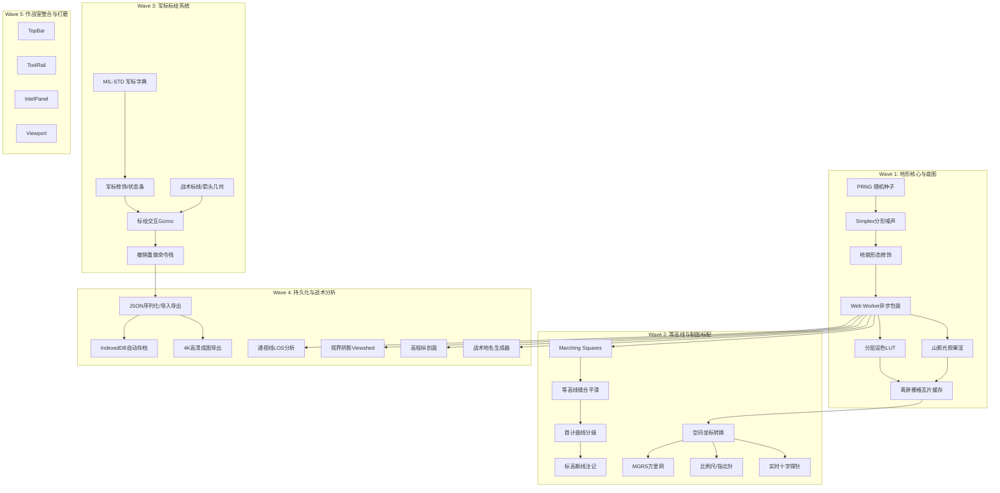

# TASKS.md — 战术地图系统 任务组件拆解与工作分解结构 (WBS)

> **关联文档**：
> - [DESIGN.md](file:///e:/Project/AntigravityIDEUsed/visualMap/DESIGN.md)（前端视觉与UI设计规范）
> - [TECHNICAL_GUIDE.md](file:///e:/Project/AntigravityIDEUsed/visualMap/TECHNICAL_GUIDE.md)（技术实施与算法指导规范）
>
> **目标**：将随机战术地图生成与态势标绘系统的全生命周期开发拆解为高内聚、低耦合的独立任务组件，明确各组件的**输入、核心逻辑、输出、依赖关系与验收标准**。

---

## 任务组件结构全景图 (Component Architecture Map)

```
                            [ 项目主视口与交互中枢 (Viewport Controller) ]
                                                │
         ┌──────────────────┬───────────────────┼───────────────────┬──────────────────┐
         ▼                  ▼                   ▼                   ▼                  ▼
   【域 A: 地形核心】  【域 B: 晕渲设色】   【域 C: 等高线系统】  【域 D: 制图网格】  【域 E: 战术标绘】
   • PRNG 种子发生器   • 分层设色 LUT      • Marching Squares   • 虚拟经纬度映射     • MIL-STD军标库
   • Simplex 分形噪声  • 山影光照计算      • 折线拓扑缝合平滑   • MGRS 军用方里网    • 标线/标面几何
   • 岛屿/山脊形态修饰 • 离屏栅格缓冲      • 首/计曲线分级渲染  • 阶梯比例尺/指北针  • 交互Gizmo手柄
   • Web Worker 多线程                     • 标高断线注记       • 实时十字探针       • 命令历史栈(Undo)
         │                  │                   │                   │                  │
         └──────────────────┴───────────────────┼───────────────────┴──────────────────┘
                                                ▼
                     ┌─────────────────────────────────────────────────────┐
                     │ 【域 F: 持久化与导出】    【域 G: 战术分析增强】     │
                     │ • JSON 态势存档/读档     • 两点通视 (LOS) 射线分析 │
                     │ • 4K 印刷级 PNG 合成导出 • 360° 阵地视界阴影       │
                     │ • 浏览器本地 IndexedDB   • 高程纵断面剖面切片图    │
                     └─────────────────────────────────────────────────────┘
```

---

## 详细任务组件清单 (Task Components)

### 域 A：地形与高程生成核心 (Terrain & Heightfield Engine)

#### `C-TERRAIN-01` 可复现伪随机发生器 (PRNG & Seed Manager)
- **职责**：确保同一 Seed 下生成完全一致的随机序列，实现以极低存储成本（仅存一个数字种子）精准重现整张地图。
- **输入**：`seed: number`（无符号 32 位整型）
- **输出**：`random(): () => number`（返回 [0, 1) 的伪随机浮点数）
- **技术实现**：Mulberry32 或 SplitMix32 轻量快速算法。
- **验收标准**：给定相同 Seed，任意平台及浏览器环境下生成的 10,000 次随机序列完全一致。

#### `C-TERRAIN-02` 多八度分形噪声发生器 (Fractal Simplex Noise / FBM)
- **职责**：生成具有自然地形连续起伏特征的高程栅格数据。
- **输入**：`width`, `height`, `scale`, `octaves` (6~8), `persistence` (0.45~0.52), `lacunarity` (2.0)
- **输出**：一维 `Float32Array`（长度 `width * height`，值域归一化至 `[0.0, 1.0]`）
- **核心逻辑**：基于 Simplex Noise 原理，按八度倍频逐层累加高频与低频扰动。
- **验收标准**：1024×1024 网格计算耗时 ≤ 30ms，无接缝锯齿与明显轴向周期瑕疵。

#### `C-TERRAIN-03` 地貌宏观形态修饰器 (Topological Shapers)
- **职责**：将纯随机噪声塑造为具备特定战术地理特征（如群岛、山谷盆地、险峻山脊）的地形。
- **子功能**：
  1. **径向衰减掩膜 (Island / Basin Falloff)**：边缘平滑过渡至负高程（水体）或山丘。
  2. **山脊锐化 (Ridged Multifractal)**：$1.0 - |2.0 \cdot H - 1.0|$，塑造锐利狭窄的山梁与陡崖。
  3. **阶地/台地化 (Terracing Filter)**：非线性高程量化，生成适合防守的阶梯状台地。
- **输入**：原始高程场 `Float32Array` + 遮罩类型参数
- **输出**：修饰后的高程场 `Float32Array`

#### `C-TERRAIN-04` 地形计算异步线程工作器 (Terrain Web Worker)
- **职责**：将计算密集型的噪声生成与修饰剥离出主线程，杜绝页面卡顿与掉帧。
- **通信接口**：通过 `postMessage` 采用 `Transferable Objects`（直接转移 `ArrayBuffer` 所有权，零内存拷贝开销）。
- **验收标准**：生成过程中 UI 界面动画与鼠标响应维持 60 FPS 无阻塞。

---

### 域 B：地貌设色与晕渲渲染 (Rendering & Shading)

#### `C-RENDER-01` 战术分层设色器 (Hypsometric Tinting Shader/LUT)
- **职责**：根据高度值将高程场转换为作战地形的基底色彩，**支持深浅双主题秒级热切换**。
- **输入**：高程场 `Float32Array` + 选定主题（`Tactical Dark` 暗色作战室 / `Military Paper` 浅色军用纸质地形图）
- **输出**：未经过光照计算的基底色彩 `Uint8ClampedArray` (RGBA)
- **色阶映射**：
  - **暗色模式**：深蓝黑水体 → 灰绿平原 → 褐绿山地 → 灰白孤峰
  - **浅色模式**：浅蓝水系 → 米白平原 → 浅草绿丘陵 → 卡其浅褐山地 → 浅灰白孤峰（经典 1:50000 纸图标准）

#### `C-RENDER-02` 坡度梯度与山影晕渲器 (Hillshade Engine)
- **职责**：模拟军用测绘标准的西北光照（315° 方位角，45° 高度角），产生强烈立体感的地形凹凸山影。
- **核心算法**：
  - 采用 Sobel 算子计算各点在 X/Y 方向的梯度斜率偏导数 $\frac{\partial z}{\partial x}$ 与 $\frac{\partial z}{\partial y}$。
  - 计算表面法向量，与光照向量进行点乘：$\text{Shade} = \cos(\theta)$。
  - 将阴影增益与 `C-RENDER-01` 的基底色彩相乘混合。
- **验收标准**：高地向阳面清晰通亮，背阴面沉稳深邃，陡崖与冲沟对比明显。

#### `C-RENDER-03` 离屏栅格瓦片缓存器 (Offscreen Raster Tile Cache)
- **职责**：将计算完毕的地形栅格渲染到离屏 Canvas，视口在平移、旋转与缩放时直接进行硬件位图变换。
- **验收标准**：在视口拖拽时，重绘耗时 ≤ 2ms。

---

### 域 C：等高线提取与标高系统 (Contour & Elevation Engine)

#### `C-CONTOUR-01` 行进方块核心提取器 (Marching Squares Core)
- **职责**：从高度栅格中精确提取离散高度阈值的等值线线段集合。
- **输入**：高程场、等高距 `interval`（例如 10m / 50m）
- **输出**：线段集合 `Array<[Point, Point]>`
- **核心逻辑**：遍历 2×2 网格方块，按 4 个角点状态构成的 16 种拓扑情况进行线性插值，计算精确交点。

#### `C-CONTOUR-02` 等高线拓扑链路缝合与 Chaikin 平滑器 (Contour Stitcher & Smoother)
- **职责**：将散落的线段缝合为连续折线（Polyline）或闭合环（Polygon），并去除阶梯网格折角。
- **核心算法**：
  - 空间哈希建立端点连通图，追踪并拼合连续轨迹。
  - 运行 2 轮 Chaikin 切角细分算法，产出自然圆润的地理等高线。
- **验收标准**：无多余线头、无孤立悬空点，折线曲率平滑自然。

#### `C-CONTOUR-03` 首曲线与计曲线分级渲染器 (Contour Hierarchy Renderer)
- **职责**：
  - **首曲线（基本等高线）**：细线（0.75px，透明度 40%）。
  - **计曲线（加粗等高线）**：粗线（1.75px，透明度 85%），每隔 5 道首曲线加粗一道。
- **验收标准**：层次分明，视觉噪声低，与底图和军标之间不抢夺焦点。

#### `C-CONTOUR-04` 标高断线动态注记器 (Contour Label Inserter)
- **职责**：在计曲线上注记海拔高度（如 `550`, `600`）。
- **算法规则**：
  - 挑选线段长度足够、曲率平缓的区域。
  - 计算等高线法线方向，文字头部始终朝向高程上升的一侧。
  - 文字背景自动叠加背景色遮罩块，使等高线在文字处产生“断开”效果，杜绝字线交织。

---

### 域 D：制图参照系与空间网格 (Grid & Spatial Reference Engine)

#### `C-GRID-01` 空间坐标投影适配器 (Geo & Screen Coordinate Adapter)
- **职责**：实现三种坐标体系的毫秒级双向无缝换算：
  1. **屏幕像素坐标**（Screen Point $[x, y]$）
  2. **地形网格坐标**（Grid $[row, col]$）
  3. **虚拟大地坐标**（WGS84 经纬度 `[lat, lon]`，支持 DMS 度分秒与 DD 十进制）
- **输入**：视口当前平移偏移量 `(offsetX, offsetY)`、缩放等级 `zoom`、锚点地理基准。

#### `C-GRID-02` 军用方里网发生器 (MGRS / Military Grid Overlay)
- **职责**：在地图视口上绘制 1km 主网格与 100m 辅网格。
- **特性**：
  - 随视口缩放自动分级淡入淡出（LOD），避免密集网格遮挡视线。
  - 在视口的上、下、左、右四周边缘绘制标准军用方里网带框度数读数（如 `84 21`、`42 88`）。

#### `C-GRID-03` 制图标配构件 (Cartographic Accessories)
- **构件包含**：
  1. **阶梯比例尺 (Graphic Scale Bar)**：根据当前缩放级别自动换算，显示真实的 500m / 1km / 5km 阶梯标尺与数字。
  2. **战术指北罗盘 (Tactical Compass)**：显示正北箭头与磁偏角，可点击一键旋转复位正北。
  3. **高程图例标尺 (Elevation Legend)**：右下角色阶渐变条，指示水体、低地、山体、高山等高程区间与当前地图极值。

#### `C-GRID-04` 准星十字与探针面板 (Crosshair & Realtime Terrain Probe)
- **职责**：鼠标在地图上滑动时，显示动态十字丝准星与悬浮信息探针。
- **读数内容**：经纬度（度分秒）、MGRS 方里网坐标、当前点海拔标高（Z）、地面坡度（Slope）、地形类型（如：低山山脊 / 谷底浅水）。

---

### 域 E：战术军标与态势标绘系统 (Tactical Symbology & Plotting Overlay)

#### `C-MIL-01` MIL-STD-2525 / APP-6 军标矢量图元字典 (Military Symbol Dictionary)
- **职责**：基于标准化军标规范，以纯 Canvas/SVG 矢量路径实现全套单位符号生成。
- **矩阵构成**：
  - **4 种阵营框架**：友军（蓝矩形）、敌军（红菱形）、中立（绿正方形）、未知（黄四叶形）。
  - **8 种核心兵种图标**：步兵（`X`）、装甲战车（椭圆履带）、机械化步兵（履带+`X`）、炮兵（实心圆点）、防空（弧顶）、侦察（单斜杠）、航空兵（双叶旋翼）、指挥所（旗标）。
- **性能规范**：预生成离屏 Sprite 缓存，支持按缩放等级动态切换细节（远景仅外框，近景显示完整图元）。

#### `C-MIL-02` 军标修饰与状态组件 (Symbol Modifiers & Decorators)
- **子元素**：
  - **编制符号**：框架顶部标注班（`●`）、排（`●●`）、连（`I`）、营（`II`）、团（`III`）、旅（`X`）。
  - **番号标签**：框架下方或右侧标注文本（如 `3rd ARMOR`）。
  - **航向标尺**：框架引出的速度与航向矢量指引线。
  - **状态条**：战备完好率（绿/黄/红分段条）。

#### `C-MIL-03` 战术标线与标面几何引擎 (Tactical Graphics Engine)
- **几何图元包含**：
  1. **主攻方向箭头**：带有宽度递增与燕尾内凹的折线多边形箭头。
  2. **前沿阻击线 / 封锁线**：沿基线带有规律单侧锯齿或三角刺的战术线。
  3. **作战区域 / 集结地**：带半透明填充与战术虚线外框的闭合多边形。
  4. **火力杀伤扇区 / 警戒雷达区**：设定中心、起始角、夹角和半径的半透明渐变扇形。

#### `C-MIL-04` 标绘交互控制器 (Plotting Interaction & Gizmo Controller)
- **交互特性**：
  - **拖拽放置**：从工具面板直接选定图标并在地图点选生成。
  - **拾取判定 (Hit Testing)**：点到点、点到折线段（最近距离阈值 6px）的高精度拾取。
  - **操控手柄 (Gizmo)**：选定单位后出现位移手柄、旋转手柄与缩放框。
  - **框选与多选**：按住 `Shift` 拖拽选框，批量移动或改变所属阵营。

#### `C-MIL-05` 标绘历史管理与命令模式 (Undo/Redo & Command Manager)
- **职责**：实现标准命令模式（`AddCommand`, `MoveCommand`, `DeleteCommand`, `ModifyPropsCommand`）。
- **特性**：提供完整的前进与后退调用栈，支持全局 `Ctrl+Z` 撤销与 `Ctrl+Y` 重做。

---

### 域 F：数据持久化与成图输出 (Persistence & Export Engine)

#### `C-DATA-01` 态势工程数据序列化器 (Project Serializer)
- **职责**：负责将当前地图参数（种子、分辨率、制图设置）与全部标绘矢量图元打包为轻量规范的 `.tacmap.json`。
- **校验机制**：基于 TypeScript 接口与 JSON Schema 校验导入文件完整性，防止损坏工程崩溃。

#### `C-DATA-02` 本地草稿与自动恢复管理器 (Local Draft Storage)
- **职责**：利用 `IndexedDB` 异步持久化当前工作态势，防止浏览器意外刷新或崩溃丢失演练数据。

#### `C-DATA-03` 4K 印刷级战术地图导出器 (Hi-Res Cartographic Exporter)
- **职责**：在离屏超宽画布（例如 3840×2160 或更大）上进行全要素合成重绘。
- **输出要素**：外围军用边框刻度、作战代号图名横幅、指北针、图例色表、比例尺、密级标签（如 `TOP SECRET // DRILL`）。
- **输出格式**：无损 PNG 图像下载与全矢量 SVG 下载。

---

### 域 G：战术分析增强组件 (Tactical Analysis Extensions)

#### `C-ANA-01` 两点间通视线分析器 (Line-of-Sight, LOS)
- **算法流程**：
  1. 用户在地图上点选观察点 A 与目标点 B。
  2. 采用空间 3D 射线与高程场采样点步进检测。
  3. 沿途若被山脊阻挡，折线在遮挡点前渲染为**绿色通视线**，遮挡点后渲染为**红色被阻盲线**，并在阻挡山头打上高程警示叉号。

#### `C-ANA-02` 观察哨视界阴影分析器 (Viewshed 360°)
- **职责**：以指定高地或侦察单位为原点，向 360° 发射径向射线，根据高程坡度比值计算遮挡，输出半透明阴影遮罩图层，清晰显示战场“死角”。

#### `C-ANA-03` 高程纵断面剖面切片器 (Cross-Section Profile)
- **职责**：测量测距线两端之间的真实起伏，在底部抽屉或浮窗中以折线图形式显示地面海拔切面。

#### `C-ANA-04` 战术地名智能生成器 (Toponym Generator)
- **职责**：扫描高程场的局部极大值点（峰顶）与鞍部，自动为关键地形赋予逼真的战术地名（如：“702高地”、“鹰嘴崖”、“双岔河”），标注于地图上。

---

### 域 H：作战室 HUD 与主界面集成 (UI Shell & Integration)

严格遵循 [`DESIGN.md`](file:///e:/Project/AntigravityIDEUsed/visualMap/DESIGN.md) 规范构建的 UI 组件：
- `C-UI-01`: 顶部指挥栏 TopBar（推演名称、ZULU 时钟、**深浅色主题一键切换**、通信链路状态、全屏/重置）。
- `C-UI-02`: 左侧战术工具轨 ToolRail（抽屉式折叠、图层切换、军标标绘箱、测距、分析工具）。
- `C-UI-03`: 右侧态势情报抽屉 IntelPanel（选定军标属性编辑、战损/兵力统计、图层显隐树）。
- `C-UI-04`: 视口相机控制器 Viewport Controller（平滑拖拽、光标中心滚轮缩放、手势支持）。

---

## 任务执行依赖与实施波次 (Execution Waves)



---

## 快速索引与代码文件规划建议

| 逻辑模块 | 建议源码文件路径 | 对应组件任务 |
| :--- | :--- | :--- |
| **数学与随机数** | `src/engine/math/prng.ts`, `simplex.ts` | `C-TERRAIN-01`, `C-TERRAIN-02` |
| **地形高程生成器** | `src/engine/terrain/generator.ts`, `worker.ts` | `C-TERRAIN-03`, `C-TERRAIN-04` |
| **晕渲着色与底图** | `src/engine/renderer/shading.ts`, `palette.ts` | `C-RENDER-01`, `C-RENDER-02`, `C-RENDER-03` |
| **等高线核心** | `src/engine/contour/marchingSquares.ts`, `chaikin.ts` | `C-CONTOUR-01`, `C-CONTOUR-02`, `C-CONTOUR-03`, `C-CONTOUR-04` |
| **制图参照系** | `src/engine/carto/projection.ts`, `mgrsGrid.ts`, `scale.ts` | `C-GRID-01`, `C-GRID-02`, `C-GRID-03`, `C-GRID-04` |
| **军标与标绘矢量** | `src/engine/tactical/symbols.ts`, `graphics.ts`, `interaction.ts` | `C-MIL-01`, `C-MIL-02`, `C-MIL-03`, `C-MIL-04` |
| **命令历史与存储** | `src/engine/tactical/commands.ts`, `storage.ts`, `export.ts` | `C-MIL-05`, `C-DATA-01`, `C-DATA-02`, `C-DATA-03` |
| **战术空间分析** | `src/engine/analysis/los.ts`, `viewshed.ts`, `toponym.ts` | `C-ANA-01`, `C-ANA-02`, `C-ANA-03`, `C-ANA-04` |
| **UI 作战室组件** | `src/ui/TopBar.tsx`, `ToolRail.tsx`, `IntelPanel.tsx` | `C-UI-01`, `C-UI-02`, `C-UI-03`, `C-UI-04` |
