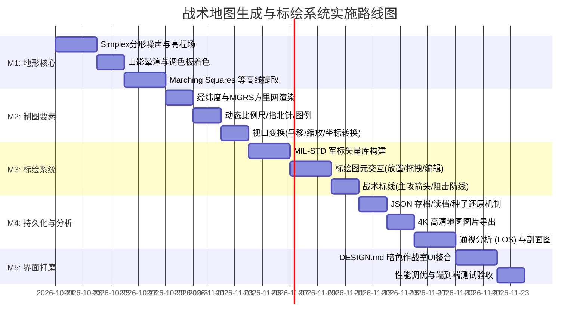

# TECHNICAL_GUIDE.md — 随机战术地图生成与标绘系统 技术实施与指导文档

> **项目代号**：VISUALMAP / TACVIEW Engine  
> **文档版本**：v1.0  
> **配套文档**：  
> - [DESIGN.md](file:///e:/Project/AntigravityIDEUsed/visualMap/DESIGN.md)（前端视觉与UI设计规范）  
> - [TASKS.md](file:///e:/Project/AntigravityIDEUsed/visualMap/TASKS.md)（任务组件拆解与工作分解结构 WBS）  
> **核心定位**：纯前端运行、高信息密度、开箱即用的随机战术地形生成与军标态势标绘平台

---

## 1. 可行性综合评估报告 (Feasibility Assessment)

### 1.1 总体评估结论
- **结论**：**100% 完全可行，具备纯前端（Zero-Backend）独立运行能力。**
- **技术成熟度**：现代 Web 平台（Canvas 2D、WebGL、OffscreenCanvas、Web Worker、Blob/File API、IndexedDB）完全足以支撑大规模高程场计算、动态等高线提取、矢量军标渲染与态势持久化。
- **运行环境**：任何现代 Chromium / WebKit / Gecko 浏览器均可秒级启动，支持离线单页部署（PWA/独立HTML打包）。

### 1.2 核心模块可行性矩阵

| 需求模块 | 核心技术方案 | 可行性等级 | 性能预期 / 资源开销 | 关键考量与优化对策 |
| :--- | :--- | :---: | :--- | :--- |
| **随机地形/高程场生成** | 种子随机 + 多八度 Simplex/Perlin 分形噪声 (FBM) + 径向遮罩与山脊扰动 | **极高 (High)** | 1024×1024 网格生成耗时 < 35ms (Web Worker) | 采用整型哈希与查表法优化噪声采样，避免主线程掉帧 |
| **山体阴影与地表设色** | 法向量点乘光照模型 (Lambertian Hillshade) + 色阶查表 (Hypsometric Tinting) | **极高 (High)** | 全图光照渲染 < 20ms，支持实时调整光照方位角 | 采用 ImageData 逐像素并行操作或 WebGL Shader 片元着色 |
| **等高线提取与标高** | 行进方块算法 (Marching Squares) + 折线简化 (Douglas-Peucker) | **极高 (High)** | 主次等高线矢量提取 < 60ms (1024 分辨率) | 划分首曲线与计曲线；仅在主等高线低曲率段注记标高 |
| **经纬度与军用方里网** | 虚拟大地坐标映射（WGS84 锚定）+ MGRS / UTM 1km/100m 网格发生器 | **极高 (High)** | 视口动态裁剪渲染 < 2ms | 视口自适应分级网格（LOD），缩放时平滑过渡刻度 |
| **战术军标标绘 (MIL-STD)** | 基于 MIL-STD-2525D / APP-6 规范的矢量图元（SVG / Canvas 路径） | **极高 (High)** | 同屏 1,000+ 标绘单位保持 60 FPS | 军标符号预渲染为离屏 Sprite/纹理图集，减少重绘开销 |
| **战术标线与标面 (态势图形)** | 贝塞尔平滑箭头、阻击线锯齿、集结地域多边形、扇形火力区 | **极高 (High)** | 纯数学几何计算，即时反馈 | 交互式控制点拖拽与碰撞判定（点到线段距离算法） |
| **地图与标绘数据持久化** | 结构化 JSON 规范（包含种子、参数、图元数组）+ 本地存储 | **极高 (High)** | 存档文件大小 < 100KB，秒级导入导出 | 种子复现机制：无需存储全量高程栅格，仅存种子与差异 |
| **高分辨率成图导出** | 离屏超采样合成 (4K/8K) + PNG/SVG 军用打印图纸生成 | **极高 (High)** | 4096×4096 导出耗时 < 1.5s | 带有边框经纬网度数、图例、比例尺、密级与指挥标头的标准图幅 |

---

## 2. 系统总体架构与分层设计 (Architecture & Layer Stack)

系统采用**解耦的数据驱动与分层视口架构**，确保复杂计算、底图渲染、矢量标绘与交互操作互不干扰：

```
┌─────────────────────────────────────────────────────────────────────────┐
│                       UI / HUD 交互外壳 (DOM / CSS)                       │
│  顶部指挥栏 · 左侧工具栏 · 右侧属性面板 · 底部态势栏 · 浮动标绘面板 · 右键菜单   │
├─────────────────────────────────────────────────────────────────────────┤
│                     Viewport 视口控制器 (Pan / Zoom)                     │
│  仿射变换矩阵 (Transform Matrix) · 屏幕坐标与地理/高程网格坐标双向转换 (Screen ↔ Geo) │
├─────────────────────────────────────────────────────────────────────────┤
│ Layer 5: 交互拾取层 (Interaction Layer)                                   │
│  选框、标绘控制锚点 (Gizmo/Handle)、测距量角标线、通视射线高亮、高程探测指针       │
├─────────────────────────────────────────────────────────────────────────┤
│ Layer 4: 态势标绘层 (Tactical Overlay Layer - Vector)                     │
│  MIL-STD 军标 (敌/我步兵、战车、火炮)、主攻箭头、前沿阻击线、集结圈、雷达扇区    │
├─────────────────────────────────────────────────────────────────────────┤
│ Layer 3: 辅助标绘与水系层 (Roads & Waters Layer)                          │
│  自适应河流网络、湖泊掩膜、战术公路/补给线、高价值高地自动注记 (Spot Elevation) │
├─────────────────────────────────────────────────────────────────────────┤
│ Layer 2: 制图学要素层 (Cartographic & Contour Layer)                     │
│  主/次等高线 (Marching Squares)、等高线标高切断注记、经纬度十字丝、方里网刻度     │
├─────────────────────────────────────────────────────────────────────────┤
│ Layer 1: 地形底图栅格层 (Terrain Raster Layer)                            │
│  高度场色彩映射 (Hypsometric Tints) + 坡度山影晕渲 (Hillshade) + 地表微纹理   │
├─────────────────────────────────────────────────────────────────────────┤
│                      后台计算工作线程 (Web Worker)                        │
│  Simplex 噪声合成 · 水力侵蚀模拟 · 等高线提取 · 通视视域 (Viewshed) 射线追踪    │
└─────────────────────────────────────────────────────────────────────────┘
```

---

## 3. 地形生成与制图学算法规范 (Terrain & Cartography Algorithms)

### 3.1 随机高度场生成算法 (Heightfield Generation)
1. **多倍频分形布朗运动 (Fractal Brownian Motion, FBM)**：
   采用多层 `Simplex Noise` 叠加，频率按倍频递增，振幅按持续度递减：
   $$H(x, y) = \sum_{i=0}^{n-1} A_i \cdot \text{Noise}(f_i \cdot x, f_i \cdot y)$$
   - 八度基数（Octaves）：`6 ~ 8` 层。
   - 持续度（Persistence）：`0.45 ~ 0.52`。
   - 粗糙度（Lacunarity）：`2.0`。
2. **地形形态掩膜 (Topological Shaping)**：
   - **海岛/盆地模式**：引入中心径向渐变权重 $M(d) = 1 - (d / R)^p$，确保四周自然成水体或盆地。
   - **山脉脊线模式 (Ridged Multi-fractal)**：通过对噪声取绝对值并反转 $H_{ridge} = 1 - |\text{Noise}(x, y)|$，生成尖锐连续的山脊与峡谷。
3. **轻量水力侵蚀算法 (Hydraulic Erosion - 可选开闭)**：
   - 粒子雨滴模拟：随机抛洒虚拟雨滴，计算局部坡度梯度，携带泥沙向低洼侵蚀并在流速减慢时沉积，生成真实的山谷沟壑纹理。

### 3.2 山影晕渲模型 (Hillshading)
通过高程场计算每个网格点的地表法向量 $\vec{N} = (n_x, n_y, n_z)$，结合战术制图通用的西北方入射光照 $\vec{L}$（方位角 $315^\circ$，俯角 $45^\circ$）：
$$\text{Slope} = \sqrt{\left(\frac{\partial z}{\partial x}\right)^2 + \left(\frac{\partial z}{\partial y}\right)^2}$$
$$\text{Aspect} = \operatorname{atan2}\left(\frac{\partial z}{\partial y}, -\frac{\partial z}{\partial x}\right)$$
$$\text{Illumination} = \cos(\text{Zenith}) \cos(\text{Slope}) + \sin(\text{Zenith}) \sin(\text{Slope}) \cos(\text{Azimuth} - \text{Aspect})$$
- 渲染增益：将照度值与地表色彩相乘，呈现清晰的向阳面高光与背阴面阴影。

### 3.3 分层设色法 (Hypsometric Tinting) 与深浅双模调色板

系统原生支持 **暗色作战室 (Tactical Dark)** 与 **浅色经典军用纸图 (Military Topo Paper)** 两套专业高程设色与制图体系：

#### (1) 高程设色梯度对照表

```
高程区间 (Elevation)   地表地貌特征            暗色作战室 (Tactical Dark)   浅色军用纸图 (Military Paper)
─────────────────────────────────────────────────────────────────────────────────────────────
< 0.00 (负高程)       深水 / 主航道           #07111C                     #C5E1F5 (浅蓝水系)
0.00 ~ 0.08          浅水 / 滩涂沙洲         #0E2238                     #DCEEFB (浅滩淡青)
0.08 ~ 0.25          平原 / 农耕低地         #12241D                     #F7F5EB (米白基底)
0.25 ~ 0.50          丘陵 / 灌木丛林         #233422                     #E7EDDC (低饱和草绿)
0.50 ~ 0.72          中高山地 / 密林         #3D3A25                     #D8DECA (黄绿山林)
0.72 ~ 0.88          高山陡崖 / 裸岩         #4A433A                     #C8BEB2 (卡其浅褐)
> 0.88               孤峰绝顶 / 冰雪积岩     #7A7F85                     #E9E7E4 (浅灰白顶)
```

#### (2) 制图要素双模适配规则

| 制图要素 | 暗色作战室 (Tactical Dark) | 浅色军用纸图 (Military Paper) | 测绘与军事规范说明 |
| :--- | :--- | :--- | :--- |
| **等高线颜色** | 冰蓝微亮色 `#5CE1FF` (透明度 40%~80%) | **测绘标准红棕色 `#7B4A2D`** | 国际大比例尺地形图标准：棕色表示陆地等高线 |
| **方里网 (MGRS)** | 暗青冷色 `rgba(120, 170, 210, 0.22)` | 墨色深灰 `rgba(30, 41, 59, 0.28)` | 保证网格纤细，不干扰高程与植被读数 |
| **经纬度与外框** | 高对比亮白 `#E6F1FA` | 炭黑 `#0F172A` | 边框带标准军用双线分度刻度 |
| **山体阴影模式** | 正片叠底微弱加深 + 高光提亮 | 灰褐向阳加亮 + 柔和阴影叠底 | 纸质图立体感强且不脏底 |

### 3.4 等高线提取与平滑 (Contour Extraction - Marching Squares)
1. **等高距设定**：
   - **计曲线 (Index Contours - 粗线)**：每 50m / 100m 一道，线宽 2px，颜色高亮并附加标高读数。
   - **首曲线 (Intermediate Contours - 细线)**：每 10m / 20m 一道，线宽 0.75px，透明度 40%。
2. **提取算法**：
   - 对高程栅格应用 **Marching Squares (行进方块)** 算法，根据 4 顶点与等高阈值生成 16 种状态的线段插值连接。
   - 拓扑闭合：将离散线段链接为多段连续的折线（Polyline）或环线（Polygon）。
   - 样条平滑：采用 **Chaikin 算法** 对等高线折线进行 2 轮切角细分，去除像素网格锯齿。
3. **标高数字排布规范 (Contour Elevation Labels)**：
   - 仅在计曲线上选定平缓、长线段位置打断绘制，字头朝向高程上升方向。
   - 标注字体统一为等宽字体 `JetBrains Mono`，文字底色带小范围深色遮罩避免与背景线粘连。

---

## 4. 制图要素与空间基准 (Cartographic Elements & Grid)

### 4.1 坐标与参考系
1. **虚拟地理锚定**：
   - 任意生成地图默认绑定一组虚拟经纬度（例如默认设定为 `N 38°42'00" ~ 38°52'00"`, `E 121°30'00" ~ 121°45'00"`）。
   - 支持经纬度（Lat/Lon，度分秒格式 `DMS`）与十进制（`DD`）实时切换。
2. **军用方里网 (MGRS / Military Grid)**：
   - 地图上方叠加正方形直角坐标网格（标准 1km 主网格，视口放大时自动展开 100m 辅网格）。
   - 图幅四周边框带标准坐标度数刻度与读数标签（如 `84 21 000m E`, `42 88 000m N`）。

### 4.2 标配制图附件
- **指北针 (North Compass)**：位于视口右上角，显示真实正北（TN）与磁北偏角（MN），可点击重置地图朝向。
- **阶梯比例尺 (Graphic Scale Bar)**：位于视口底边居中，精确随缩放动态计算，显示米（m）、公里（km）与海里（NM）。
- **高程与图例面板 (Elevation Legend)**：可展开的右下/左下微缩图例，指示等高距、高程区间色谱及最高点/最低点标高。
- **实时十字丝探针 (Crosshair & Terrain Probe)**：鼠标悬停任意位置时，显示当前点坐标、高度（Z值）、坡度（Slope）与地貌类别。

---

## 5. 战术标绘与军标系统规范 (Tactical Symbology & Overlay)

### 5.1 战术军标规范 (遵循 MIL-STD-2525D / NATO APP-6D)

军标由 **外框属性（Identity） + 兵种符号（Icon） + 编制规模（Echelon） + 状态与战术文字** 组成：

```
           [ 编制规模 Echelon (如: II 营 / I 连) ]
┌───────────────────────────┬───────────────────────────┐
│                           │                           │
│  [单位番号 Unit Name]     │     [ 兵种图形符号 ]      │  [ 状态色条 Status ]
│  例: "3rd ARMOR"          │     (如: 履带/交叉X)       │  (绿:良好 / 黄:告警)
│                           │                           │
└───────────────────────────┴───────────────────────────┘
           [ 航向矢量线 / 速度标尺 Heading Vector ]
```

#### (1) 敌我识别框架 (Identity / Affiliation)
| 阵营身份 | 框架外形 | 描边色 | 填充色 (透明度 20%) | 战术含义 |
| :--- | :---: | :---: | :---: | :--- |
| **友方 (Friendly)** | 圆角矩形 / 圆形 | `#4DA8FF` (天蓝) | `rgba(77, 168, 255, 0.2)` | 我军及协同部队 |
| **敌方 (Hostile)** | 45° 旋转菱形 | `#FF4D5E` (警戒红) | `rgba(255, 77, 94, 0.2)` | 敌军确定目标 |
| **中立 (Neutral)** | 正方形 | `#3DDC97` (中立绿) | `rgba(61, 220, 151, 0.2)` | 平民设施、第三方 |
| **未知 (Unknown)** | 四叶形 / 三叶圆弧 | `#FFD84D` (侦察黄) | `rgba(255, 216, 77, 0.2)` | 待判明、雷达未确知接触 |

#### (2) 预置核心兵种图标字典 (Branch Icons)
- **步兵 (Infantry)**：框架内对角交叉线（`X`）。
- **装甲/战车 (Armor/Tank)**：框架内椭圆形履带轮廓。
- **机械化步兵 (Mechanized)**：椭圆履带 + 内部对角交叉线 `X`。
- **炮兵 (Artillery)**：框架中心实心圆点（`●`）。
- **防空部队 (Air Defense)**：框架底部朝上的半圆弧拱形（`∩`）。
- **侦察部队 (Recon)**：从左下到右上单条对角斜线（`/`）。
- **航空兵/直升机 (Aviation)**：水平哑铃状双叶螺旋桨线段。
- **指挥所/司令部 (Headquarters)**：军标左侧向下延伸指挥标旗杆。

#### (3) 编制级别标识 (Echelons)
- 班（Squad）：`●`
- 排（Platoon）：`●●`
- 连（Company）：`I`
- 营（Battalion）：`II`
- 团（Regiment）：`III`
- 旅（Brigade）：`X`
- 师（Division）：`XX`

---

### 5.2 战术标线与标面符号 (Tactical Graphics)

1. **主攻方向箭头 (Main Attack Arrow)**：
   - 带有燕尾与加宽箭头的折线多边形，跟随作战阵营颜色。
   - 控制点机制：由起点、若干转折控制点、箭头末端点构成，支持二次贝塞尔曲线平滑。
2. **前沿防线 / 阻击线 (Front Line / Obstacle)**：
   - 实线主轴，朝向敌方一侧带有连续等距小三角形或锯齿刺。
3. **集结地 / 作战封锁区 (Assembly Area / Area of Operation)**：
   - 半透明多边形，边框为虚线（友军）或带斜线纹理（敌军），带有区域代号（如 `AO VIPER`）。
4. **雷达探测 / 火力射程扇区 (Sector / Viewshed)**：
   - 以单位坐标为圆心，设定起始方位角、张角和射程半径，绘制渐变扇面。

---

### 5.3 交互机制规范
- **添加标绘**：从左侧工具栏拖拽或点击选定军标，在地图任意坐标点击即刻生成。
- **位移与旋转**：鼠标左键拖拽单位移动；点击选定后出现朝向操控手柄（Gizmo），旋转调整朝向角度。
- **属性编辑**：双击军标或右键呼出属性抽屉，即时修改阵营、兵种、编制、番号、战备状态与附加备注。
- **撤销与重做**：全量操作接入 `Command Pattern`（命令模式），支持 `Ctrl+Z` / `Ctrl+Y`。

---

## 6. 数据模型与持久化规范 (Data Schema & Storage)

为实现轻量化保存与完美重现，系统采用**分层序列化架构**：地图底层仅保存生成参数与随机种子（Seed），标绘图层保存完整矢量对象数组。

### 6.1 战术地图全量存档 JSON 结构定义 (`.tacmap.json`)

```typescript
export interface TacticalMapProject {
  version: "1.0.0";
  meta: {
    id: string;               // 唯一项目UUID
    name: string;             // 作战态势名称，例如 "铁幕行动-演练01"
    createdAt: string;        // ISO 8601 时间戳
    updatedAt: string;
    author?: string;
  };

  // 1. 地形高程场生成规范 (轻量还原核心)
  terrain: {
    seed: number;             // 随机数发生器种子 (如 4829104)
    resolution: 512 | 1024 | 2048; // 网格精度
    scale: number;            // 噪声缩放因子
    octaves: number;          // 八度分形数 (6~8)
    persistence: number;      // 0.48
    lacunarity: number;       // 2.0
    radialFalloff: boolean;   // 是否开启四周海岛/盆地遮罩
    waterLevel: number;       // 水平面高度截断阈值 (0.0 ~ 1.0)
    peakHeight: number;       // 最高峰模拟标高 (米，例如 1850m)
    colorTheme: "tactical-dark" | "military-topo" | "satellite-tint" | "night-vision";
  };

  // 2. 制图要素配置
  cartography: {
    originGeo: { lat: number; lng: number }; // 地图中心对应虚拟基准经纬度
    gridType: "MGRS" | "LAT_LON" | "UTM";   // 网格类型
    contourInterval: number;                 // 等高距 (米，例如 20m)
    showContourLabels: boolean;              // 是否显示等高线数值
    showHillshade: boolean;                  // 是否启用山影晕渲
    lightAzimuth: number;                    // 光照方位角 (默认 315°)
    lightAltitude: number;                   // 光照高度角 (默认 45°)
  };

  // 3. 战术标绘图元数组 (Tactical Markers & Overlays)
  overlays: TacticalEntity[];

  // 4. 视口保存状态
  viewport: {
    center: [number, number]; // 视口中心点坐标
    zoom: number;             // 缩放级别
    rotation: number;         // 旋转角
  };
}

export type TacticalEntity = UnitMarker | TacticalGraphic | AreaMarker;

// 军标单位实体定义
export interface UnitMarker {
  id: string;
  type: "unit";
  affiliation: "friend" | "hostile" | "neutral" | "unknown";
  branch: "infantry" | "armor" | "mechanized" | "artillery" | "air-defense" | "recon" | "hq";
  echelon: "squad" | "platoon" | "company" | "battalion" | "regiment" | "brigade";
  name: string;               // 单位番号，如 "1st Tank Bn"
  position: [number, number]; // 地图绝对像素或相对地理坐标 [x, y]
  heading: number;            // 航向角 0~360°
  speedKmH?: number;          // 航速
  strengthPercent: number;    // 战斗力百分比 (0~100)
  customNotes?: string;       // 态势情报备注
  tags?: string[];
}

// 战术图形定义 (箭头、线段)
export interface TacticalGraphic {
  id: string;
  type: "arrow" | "frontline" | "boundary" | "sector";
  affiliation: "friend" | "hostile" | "neutral";
  points: [number, number][]; // 折线顶点控制点序列
  width?: number;
  label?: string;
  radius?: number;            // 扇形专用
  startAngle?: number;
  endAngle?: number;
}
```

### 6.2 存储与导出机制
1. **浏览器内部持久化**：
   - 自动保存草稿至 `IndexedDB` 或 `localStorage`，页面刷新或意外关闭时自动恢复现场。
2. **本地文件持久化 (Import / Export)**：
   - **导出工程文件**：下载 `.tacmap.json`，支持团队分发与离线归档。
   - **导入工程文件**：文件拖入视口即刻恢复地形种子、图层及全部标绘。
3. **成果高清成图导出**：
   - **高清 PNG / JPEG 战术地图**：离屏渲染合成全部要素，包含边框度数、图例、经纬度十字丝和比例尺（支持 2K/4K/8K 分辨率）。
   - **矢量 SVG 导出**：导出全矢量图层的等高线与军标，适配后续专业制图软件与大幅打印需求。

---

## 7. 增强功能规划 (Bonus Tactical Capabilities)

为打造真正具备专业战术推演质感的平台，规划以下高价值增强模块：

```
┌────────────────────────────────────────────────────────────────────────┐
│                        战术分析增强功能集                              │
├──────────────────┬──────────────────┬──────────────────┬───────────────┤
│ 1. 通视分析 (LOS)│ 2. 射界分析      │ 3. 地形剖面切片  │ 4. 战术地名   │
│ 动态计算两点间视 │ (Viewshed)       │ (Cross-Section)  │ 智能生成器    │
│ 线通断，红绿标示 │ 指定标绘单位侦察 │ 沿测距线实时生成 │ 依据鞍部、山峰│
│ 遮挡高程点       │ 半径内的地形盲区 │ 高程起伏剖面图   │ 命名"702高地" │
└──────────────────┴──────────────────┴──────────────────┴───────────────┘
```

1. **两点间通视线分析 (Line-of-Sight, LOS)**：
   - 操作：在地图上连接两点（如我方狙击观察哨与敌方装甲车）。
   - 算法：沿射线采用 **Bresenham 高程采样**，若中途存在地表高程阻挡视线，通视线切断为红色盲段，通视段为绿色净空段。
2. **单点全景通视阴影 (Viewshed Analysis)**：
   - 操作：右键单位点击“探测视野”。
   - 算法：以该点为中心向 360 度发射等角射线，标记由于山体背阴阻挡而无法观察到的战术死角。
3. **智能地名生成器 (Toponym Generator)**：
   - 对高度场执行局部极大值查找提取山顶（Peak）、局部极小值鞍部（Saddle）与水源交汇处。
   - 自动生成军事地名标签（如：“红石崖”、“318高地”、“夹皮沟”、“断桥集”），极大增强战术代入感。

---

## 8. 技术栈选型与工程建议 (Recommended Tech Stack)

```
┌─────────────────────────┬──────────────────────────────────────────────┐
│ 模块                    │ 推荐选型与技术方案                           │
├─────────────────────────┼──────────────────────────────────────────────┤
│ 核心底座                │ HTML5 + Modern CSS (Variables/Tokens) + TS   │
│ UI 与组件架构           │ 纯原生 Web Components 或 轻量 React / Vue    │
│ 图形渲染引擎            │ HTML5 Dual Canvas (离屏栅格 + 交互矢量 Canvas)│
│ 数学与几何计算          │ SimplexNoise.js + MarchingSquares 自研轻量库 │
│ 军标渲染体系            │ 内置标准军标 SVG / Canvas 矢量路径字典       │
│ 多线程计算              │ Web Worker (高度场与等高线计算不卡主线程)    │
│ 图标库                  │ Lucide Icons (符合 DESIGN.md 战术细线风格)   │
└─────────────────────────┴──────────────────────────────────────────────┘
```

---

## 9. 阶段化实施路线图 (Implementation Roadmap)



### 里程碑交付目标
- **M1（地形核心引擎）**：可以在 Canvas 上稳定秒级生成带山峰、山脊、平原、湖泊的高程彩色晕渲图，并叠加精确等高线。
- **M2（标准制图体系）**：支持流畅平移缩放、网格随缩放动态精细化、实时经纬度和高度读数探测、比例尺与指北针联动。
- **M3（态势标绘引擎）**：能够随心放置红方（敌战车、敌步兵、火炮）、蓝方军标，可拖拽、旋转、修改番号和属性，可绘制战术主攻箭头。
- **M4（全量持久化与导出）**：一键保存/载入当前战术推演工程（JSON），一键无损导出高清打印级带图例 PNG 图片，支持两点通视测量。
- **M5（作战室系统整合）**：严格遵循 `DESIGN.md` 设计规范完成 UI 与交互整合，交付专业、震撼的现代化战术态势分析网页系统。
